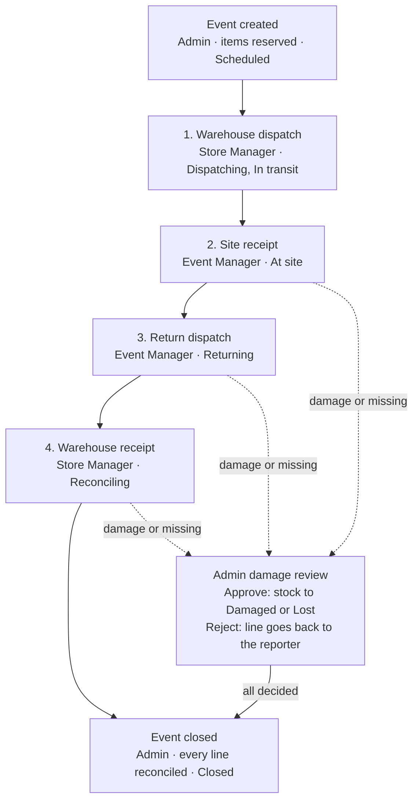

# Artoholic — Product & Business Requirements (PRD/BRD)

Version 1.1 · 2026-11-19 · Source document for Spec-Kit (exported from the shared PRD/BRD doc)

## 0. Document control

This is version 1.1 (owner decisions applied) of the combined PRD and BRD for the Artoholic platform: one web app, one Android app and one iOS app. It expands the owner's two-page draft. Once ratified, it becomes the source document for Spec-Kit (`/speckit-constitution`, then `/speckit-specify` once per feature), the same way `docs/PRD-v1.1-source.md` was used for the Service Management tool.

| Item | Value |
| --- | --- |
| Product | Artoholic Event Operations Platform (working name) |
| Client | Artoholic, an event management company (weddings, private and corporate functions, political rallies) |
| Surfaces | Responsive web app; Android app; iOS app |
| Version | 1.1 |
| Source | Owner's draft "Artoholic\_PRD\_BRD.docx" |
| Approver | Owner (Super Admin) |

**How to read the requirement tables.** Each requirement has an ID (for example `INV-04`), a priority and a source.

- **Priority:** `Must` = needed for the first release (MVP). `Should` = planned for the MVP if time allows, otherwise Phase 2. `Could` = later phase.
- **Source:** `Draft` = stated in the owner's draft. `Proposed` = added in this version to fill a gap. Every `Proposed` item needs the owner's yes or no before it goes into a spec.

**Change log**

| Version | Date | Change |
| --- | --- | --- |
| 1.1 | 2026-11-19 | Owner answered Q1 to Q14 and confirmed 3-year retention and the stack; decisions applied (section 13) |
| 1.0 draft | 2026-11-19 | First detailed PRD/BRD, expanded from the owner's draft |

## 1. Executive summary and business context

Artoholic needs one system that tracks every physical item it owns, from the warehouse shelf to the event site and back, and shows who is accountable for it at each step. Today that tracking is assumed to be manual (spreadsheets, phone calls, WhatsApp photos). That makes it hard to know what stock is free for an event, where an item is stored, what came back damaged, and who approved the loss.

The platform has three modules in the first release:

1. **Inventory management:** categories, items, units of measure, quantities, damage tracking, scheduled physical counts and stock adjustments. Includes "cut products" (items such as fabric or carpet that are cut to length and partly used up).
2. **Warehouse management:** multiple warehouses, each with user-defined storage locations (for example aisle → row → box), and store managers who can be assigned to several warehouses.
3. **Event management:** an admin creates an event and lists the items it needs. The platform then drives a four-step checklist with photo evidence and admin approval: warehouse dispatch, site receipt, site return dispatch, warehouse receipt.

Around these sit user and role management, notifications (in-app, push, WhatsApp, email), and reports on demand or on a schedule, delivered as Excel files by WhatsApp and email.

### 1.1 Problem statement

| Problem today (assumed) | Business impact | What the platform does |
| --- | --- | --- |
| Stock levels and locations live in people's heads or in spreadsheets | Items are double-booked or can't be found on loading day | One live stock ledger per item, per warehouse location |
| No checklist between warehouse, truck and site | Items go missing with no clear owner | A dispatch and receipt checklist at every handover, with quantities |
| Damage is reported informally | Losses are not recovered from clients or staff, and stock counts drift | Damage marked per item with a photo, approved by the admin, posted to stock |
| Physical counts happen irregularly | Stock records can't be trusted | Scheduled physical counts with variance review and approved adjustments |
| Managers chase each other by phone | Slow and error-prone preparation | Automatic notifications at each step |

### 1.2 Business case

- **Fewer losses:** every item that leaves a warehouse is counted back in, or written off with a photo and an approver.
- **More events with the same stock:** stock that is visibly free can be committed with confidence.
- **Less admin time:** reports arrive on WhatsApp and email on a schedule, with no manual compiling.
- **Room to grow:** the module structure leaves room for later modules such as vendors, clients, quotations, billing and crew.

## 2. Business objectives and success metrics

The MVP succeeds if, within 3 months of go-live, every event's items move through the platform's checklists and stock records match physical counts to within 2%. All targets below are proposals for the owner to confirm or replace.

| # | Objective | KPI | Target (proposed) | Measured from |
| --- | --- | --- | --- | --- |
| O1 | Trustworthy stock records | Physical-count variance (value or quantity of items that differ ÷ total) | ≤ 2% by the third scheduled count | Physical count results |
| O2 | Every item accounted for after each event | Events closed with 100% of dispatched quantity reconciled (returned, or damaged/lost and approved) | 100% of closed events | Event checklists |
| O3 | Faster preparation | Median time from event creation to dispatch complete | Baseline in month 1, then 20% lower by month 3 | Event timestamps |
| O4 | Faster damage decisions | Median time from damage report to admin decision | < 24 hours | Damage approvals |
| O5 | Adoption | Share of events run fully in the app | 100% from month 2 | Events |
| O6 | Less reporting effort | Scheduled reports delivered on time | ≥ 99% | Report delivery log |
| O7 | Over-bookings resolved early | Over-booking warnings resolved before the leave-warehouse date | 100% | Reservations |

## 3. Scope

The MVP covers the five areas in the owner's draft: users and roles, inventory, warehouses, events and reports. It also adds the notifications and audit trail those areas need. Commercial modules (clients, quotes, billing) are out of the MVP.

### 3.1 In scope (MVP)

- User management with multiple roles per user; login on web, Android and iOS.
- Item categories, items, units of measure (or none), quantities, cut products, damaged and lost stock.
- Multiple warehouses with user-defined location levels (aisle, row, box and so on); stock held per location.
- Physical-count schedules (weekly, monthly, quarterly, half-yearly, yearly), count sheets, variances and approved adjustments.
- Event creation with event managers, store managers, dates, location and required items.
- The four-step event checklist (dispatch, site receipt, return dispatch, warehouse receipt) with quantities, photos and admin approval of damage.
- Event closure, plus admin view and edit of closed events, fully audited.
- Notifications: in-app, push (Android and iOS), WhatsApp and email.
- Reports on demand and on a schedule, exported to Excel and sent by WhatsApp and email.
- Super Admin console and a permanent audit log.

### 3.2 Out of scope (MVP)

- Client (customer) records, quotations, invoicing and payments.
- Purchasing and vendor management (buying new stock, purchase orders).
- Crew and labour scheduling, vehicles and transport bookings.
- Rental of items from or to third parties, and consumables such as tape, nails and fresh flowers. Consumables are not tracked (owner decision Q7).
- Barcode or QR scanning: Phase 2 (owner decision Q6).
- Offline mode: the MVP needs a data connection; Phase 2 adds offline checklists for event sites.
- Languages other than English (Phase 2; see question Q9).

### 3.3 Phased releases (proposed)

| Phase | Theme | Contents |
| --- | --- | --- |
| MVP (Phase 1) | Run every event on the platform | Everything in 3.1 |
| Phase 2 | Faster on the ground | QR or barcode labels and scanning; offline checklists with sync; item kits and bundles; stock transfers between warehouses; Hindi or regional languages; reorder alerts |
| Phase 3 | Commercial | Clients, quotations from item lists, invoicing, damage charges to clients, vendors and sub-rentals, crew and vehicle scheduling, repair workflow and repair costs, client-facing event portal |

## 4. Stakeholders, user roles and personas

The MVP has four roles. One user can hold several at once (for example Event Manager plus Store Manager), and their permissions add up. Only the Super Admin can create or change Admins.

### 4.1 Roles

| Role | Who | Count | Core job in the platform |
| --- | --- | --- | --- |
| Super Admin | The product owner and developer only | 1 | Platform configuration, Admin accounts, integrations (WhatsApp, email), message templates, audit log, system health. Not an operational role. |
| Admin | Artoholic owners or senior operations staff | A few | Full access to all business data: users, catalogue, warehouses, events, approvals, count schedules, reports. Approves damage and stock adjustments. Can view and edit closed events. |
| Event Manager | Staff who run events on site | Many | Sees assigned events, receives items at the site, records damage with photos, dispatches items back to the warehouse. |
| Store Manager | Staff who run warehouses | Several | Manages stock in assigned warehouses (one or many), picks and dispatches items for events, receives returns, performs physical counts. |

### 4.2 Personas

- **Ravi, Admin (web, sometimes phone):** plans the week's events from the office. Wants to see in one place whether the items are available, approve damage quickly from his phone, and get a Monday-morning stock report on WhatsApp.
- **Priya, Event Manager (phone, at the venue):** busy, often has a weak signal, takes photos with her phone. Wants a simple checklist with big tap targets: tick, count, photo, done.
- **Suresh, Store Manager (Android phone or warehouse tablet):** manages 2 warehouses. Wants a pick list grouped by location (aisle → row → box) so loading is fast, and a count sheet for scheduled counts.

### 4.3 Permission matrix (proposed)

Key: **F** = full, **A** = assigned records only, **V** = view only, **–** = none.

| Capability | Super Admin | Admin | Event Manager | Store Manager |
| --- | --- | --- | --- | --- |
| Create and edit Admins | F | – | – | – |
| Create and edit other users and roles | F | F | – | – |
| Platform settings, integrations, templates | F | V | – | – |
| Categories, items, units of measure | F | F | V | V (edit stock only) |
| Warehouses and location setup | F | F | – | A |
| View stock levels | F | F | V | A |
| Create, edit and cancel events | F | F | – | – |
| View events | F | F | A | A |
| Warehouse dispatch and receipt steps | F | F | – | A |
| Site receipt and return dispatch steps | F | F | A | – |
| Report damage or loss with photo | F | F | A | A |
| Approve damage, loss and stock adjustments | F | F | – | – |
| Physical-count schedules | F | F | – | – |
| Perform a physical count | F | F | – | A |
| Edit a closed event | F | F | – | – |
| Run reports | F | F | A | A |
| Report schedules and recipients | F | F | – | – |
| Audit log | F | V | – | – |

## 5. Event types and the event lifecycle

Every event, from a 50-guest birthday to a 50,000-person political rally, follows the same lifecycle. It differs only in scale: the number of items, warehouses and dispatch rounds.

**Event types (proposed starting list, Admin-editable):** Wedding, Engagement or Reception, Birthday or Private party, Corporate event, Conference or Exhibition, Concert or Cultural show, Political rally or Public meeting, Religious or Community function, Other.

Each handover is a checklist step that one role submits and the next role picks up. Damage or shortfall at steps 2, 3 or 4 goes to an Admin for photo review. The event closes only once every line is reconciled and every review is decided. Admins can still correct a closed event later (EVT-21).

## 6. Functional requirements

Requirements are grouped by module. Each module becomes one or more Spec-Kit features (section 14). The acceptance criteria are written so they can turn directly into Given/When/Then scenarios in `spec.md`.

### 6.1 User and access management (USR)

| ID | Requirement | Priority | Source |
| --- | --- | --- | --- |
| USR-01 | An Admin (or the Super Admin) creates a user with: full name, phone number (mandatory, unique, with country code, default +91), email (optional, unique if given), username, password, and one or more roles. | Must | Draft |
| USR-02 | The username defaults to the email address. If there is no email, it defaults to the phone number. The creator can override it; it must be unique. | Must | Draft + Proposed fallback |
| USR-03 | A user can hold several roles; their permissions are the union of those roles (section 4.3). | Must | Draft |
| USR-04 | Store Managers are assigned to one or more warehouses, and see and act only on those warehouses. | Must | Draft |
| USR-05 | There is exactly one Super Admin, seeded at install and never creatable from the app. Only the Super Admin can create, edit or deactivate Admins. | Must | Draft |
| USR-06 | Users sign in with username, email or phone, plus password, on all three apps. | Must | Proposed |
| USR-07 | Forgotten password: a one-time code is sent by WhatsApp (and email if present). It expires after 10 minutes; at most 5 attempts are allowed. | Must | Proposed |
| USR-08 | A temporary password set by an Admin must be changed at first login. | Should | Proposed |
| USR-09 | Users are deactivated, never deleted, so their history stays intact. A deactivated user's sessions end immediately on every device. | Must | Proposed |
| USR-10 | Mobile sessions stay signed in for up to 30 days and support device biometrics (fingerprint, Face ID) to unlock. | Should | Proposed |
| USR-11 | An Admin cannot remove the last Admin role or deactivate their own account. | Must | Proposed |

**Acceptance criteria**

- Given an Admin creating a user without a phone number, when they save, then the form is rejected with "Phone number is required".
- Given a new user with email `ravi@example.com` and no username typed, when saved, then the username is `ravi@example.com`.
- Given a user with Event Manager and Store Manager roles, when they open an event they are assigned to in both roles, then they can perform both the warehouse and the site steps.

### 6.2 Inventory management (INV)

Every item belongs to a category and has one of three tracking types: counted (pieces), measured (a unit of measure) or cut product. Stock is always held per warehouse location and per condition, so "quantity on hand" is a sum, never a typed number.

**Item tracking types (proposed)**

| Type | Example | Quantity is | Notes |
| --- | --- | --- | --- |
| Counted | Chairs, LED par lights, vases | Whole pieces, no unit | The draft's "items with no UoM" |
| Measured | Rope, cable, LED strip | Decimal amount in a unit (m, cm, kg, L) | Can be partly used up at an event |
| Cut product | Carpet rolls, fabric, drape cloth | Each roll or piece tracked with its current length | Cutting makes a shorter piece plus an offcut; consumed length is recorded per event |

**Stock conditions (proposed):** Available, Reserved (committed to a future event), Out (at an event), Damaged (awaiting a decision), Lost, Written off.

| ID | Requirement | Priority | Source |
| --- | --- | --- | --- |
| INV-01 | Admins create, edit and archive categories (two levels: category → sub-category). | Must | Draft + Proposed sub-level |
| INV-02 | Admins manage the list of units of measure (m, cm, ft, kg, g, L, set, pair, and so on), including conversions within a family (100 cm = 1 m). | Must | Draft |
| INV-03 | Admins create items with: name, code or SKU (auto-generated, editable), category, description, tracking type, unit of measure (none for counted items), photos (up to 5), replacement value (₹), minimum-stock level, and notes. | Must | Draft + Proposed fields |
| INV-04 | Opening stock is entered per warehouse location, with condition, and can be bulk-imported from Excel or CSV. | Must | Proposed |
| INV-05 | Every stock change is a ledger entry (receipt, dispatch, return, adjustment, damage, write-off, cut, transfer), with user, time, reason and the linked event or count. Stock is never edited directly. | Must | Proposed |
| INV-06 | Cut products: each roll or piece has its own record (piece ID, original length, current length, location). Recording a cut creates the used piece and keeps the offcut in stock; pieces below a set minimum length can be written off. | Must | Draft ("cut products") + Proposed design |
| INV-07 | **Item view** shows: name, description, unit, photos, quantity on hand by condition (available, reserved, out, damaged, lost), stock by warehouse and location, the last event it was used in, upcoming reservations, and its full ledger history. | Must | Draft |
| INV-08 | The item view shows a damage summary: total damaged to date, currently damaged, written off, and the events in which damage happened (with photos). | Must | Draft |
| INV-09 | Damaged stock is either written off (needs Admin approval) or returned to Available if it turns out to be usable. A repair workflow (in-house or vendor, with costs) is a later phase (owner decision Q14). | Should | Proposed |
| INV-10 | Items search and filter by name, code, category, warehouse, condition and "below minimum stock". | Must | Proposed |
| INV-11 | An alert goes to Admins when available stock falls below the item's minimum level. | Could | Proposed |

**Physical count and stock adjustment (PHC)**

| ID | Requirement | Priority | Source |
| --- | --- | --- | --- |
| PHC-01 | Admins set up count schedules: frequency (weekly, monthly, quarterly, half-yearly, yearly), start date, scope (all items, or chosen warehouses or categories) and the assigned Store Manager(s). | Must | Draft |
| PHC-02 | On the due date the system creates a count session and notifies the assignees. Admins can also start an ad-hoc count at any time. | Must | Draft + Proposed ad-hoc |
| PHC-03 | The count sheet lists items by location, in walking order. By default it hides the system quantity (a "blind count"); an Admin can turn this off per schedule. | Must | Proposed |
| PHC-04 | The counter enters the counted quantity per item and location (per piece for cut products), with an optional photo and note. The counter can save and resume. | Must | Draft |
| PHC-05 | On submit, the system shows the variance per line (counted minus system, in quantity and ₹). | Must | Draft |
| PHC-06 | An Admin approves or rejects each variance line, with a reason. Approved lines post adjustment entries to the ledger. Rejected lines go back for a recount. | Must | Draft |
| PHC-07 | Items with an event dispatch or return in progress are flagged on the count sheet, so counts don't clash with live movements. | Should | Proposed |
| PHC-08 | A missed count (not submitted 3 days after the due date) is escalated to Admins. | Should | Proposed |

**Acceptance criteria**

- Given an item with 50 available, 20 reserved and 5 damaged, when the item view opens, then it shows on hand = 75 broken down by those conditions, plus the last event it went to.
- Given a carpet roll of 30 m, when a store manager records a 12 m cut for an event, then the roll shows 18 m in stock and the event shows 12 m dispatched.
- Given a monthly count with a variance of −3 chairs, when the Admin approves it, then a −3 adjustment entry is posted with the count's reference and the Admin's name.

### 6.3 Warehouse management (WHS)

Each warehouse defines its own location levels, so one site can use Aisle → Row → Box and another Room → Rack → Shelf. Every stock quantity points at the lowest level, its "bin".

| ID | Requirement | Priority | Source |
| --- | --- | --- | --- |
| WHS-01 | Admins create warehouses with: name, code, address, map pin, contact phone, and assigned Store Manager(s). A warehouse can have several Store Managers, and a Store Manager can have several warehouses. | Must | Draft |
| WHS-02 | Admins define each warehouse's location levels (1 to 5 levels, named by the user, for example Aisle, Row, Box). | Must | Draft |
| WHS-03 | Store Managers and Admins create locations within those levels, singly or in bulk (for example "Aisle A, Rows 1–10, Boxes 1–5"). Each location gets a readable code such as `WH1-A-03-B2`. | Must | Draft + Proposed bulk |
| WHS-04 | An item can sit in many locations; the item view shows quantity per location. | Must | Draft |
| WHS-05 | Store Managers move stock between locations in the same warehouse (a put-away or move), recorded in the ledger. | Must | Proposed |
| WHS-06 | Stock transfer between warehouses: request, dispatch, receive, with in-transit stock shown separately. | Should | Proposed |
| WHS-07 | A location that holds stock cannot be deleted; it can be deactivated after it is emptied. | Must | Proposed |
| WHS-08 | Locations can print QR labels (Phase 2 scanning uses them). | Could | Proposed |

**Acceptance criteria**

- Given warehouse "Main" with levels Aisle → Row → Box, when a Store Manager creates Aisle A with rows 1–3 and boxes 1–2, then 6 bin locations are created with codes `MAIN-A-01-01` through `MAIN-A-03-02`.
- Given a Store Manager assigned only to "Main", when they open the stock list, then they see only Main's stock.

### 6.4 Event management (EVT)

An event is a plan, a reservation of stock and a four-step checklist. Each line on the checklist records planned, dispatched, received, returned, damaged and missing quantities, so every item is reconciled before the event can close.

**Event creation**

| ID | Requirement | Priority | Source |
| --- | --- | --- | --- |
| EVT-01 | Admins create an event with: name, description, location (venue name, address, map pin), start date and time, end date and time, the date (and time) items leave the warehouse, Event Manager(s) (one or more), Store Manager(s) (one or more), and required items. | Must | Draft |
| EVT-02 | Extra event fields: event type (Wedding, Reception, Corporate, Birthday, Political rally, Concert, Exhibition, Other; Admin-editable list), expected return date (when items should be back), site contact, and notes. | Should | Proposed |
| EVT-03 | Each required-item line has: item, quantity (or length for cut products) and the source warehouse. The system suggests the warehouse with enough available stock and can split one line across warehouses. | Must | Draft + Proposed |
| EVT-04 | Availability check: while adding items, the system shows available stock for the event's date window (leave-warehouse date → expected return date), after other events' reservations. Over-booking is allowed, but the event shows an over-booking warning that names the short items and the clashing events. The warning goes to the event's Admin, Event Manager(s) and Store Manager(s). | Must | Owner decision Q4 |
| EVT-05 | Saving an event reserves the stock. Editing quantities before dispatch updates the reservation; cancelling the event releases it. | Must | Proposed |
| EVT-06 | The Store Manager(s) suggested for an event are the ones assigned to the source warehouses. Admins can change them. | Should | Draft ("depending on where the item is present") |
| EVT-07 | Admins can copy an existing event as a template (same items and quantities, new dates). | Should | Proposed |
| EVT-08 | Saving an event notifies its Event Manager(s) and Store Manager(s) to start the warehouse dispatch (in-app, push, WhatsApp). | Must | Draft |

**The four-step checklist**

| ID | Step | Done by | Requirement | Priority | Source |
| --- | --- | --- | --- | --- | --- |
| EVT-10 | 1. Warehouse dispatch | Store Manager | The item list is a table. Per line the Store Manager ticks it and enters the dispatched quantity, in the same table. Lines are grouped by warehouse and sorted by location so picking follows the aisles. They can save part-way, then submit. Submitting moves stock from Reserved to Out and notifies the Event Manager(s). Optional transport fields: vehicle number, driver name, driver phone (owner decision Q8). | Must | Draft |
| EVT-11 | 1a. Short dispatch | Store Manager | If dispatched < planned, a reason is required (out of stock, damaged on pick, Admin decision). The Admin is notified. | Must | Proposed |
| EVT-12 | 2. Site receipt | Event Manager | At the site, the Event Manager uses the same table to enter, per line, the received quantity and any damaged quantity. Damaged lines need at least 1 photo and a note. Missing quantity (dispatched − received) is computed and must be confirmed. | Must | Draft |
| EVT-13 | 2a. Damage approval at receipt | Admin | Submitting a receipt with damage or missing items notifies the Admin. The Admin reviews the photos and approves (stock moves to Damaged or Lost) or rejects with a comment (the line goes back to the Event Manager). | Must | Draft |
| EVT-14 | 3. Return dispatch | Event Manager | After the event, the item list acts as a checklist. The Event Manager enters the quantity dispatched back per line (and remaining length for cut products), marks damage with photos, and submits. The Store Manager(s) are notified. | Must | Draft |
| EVT-15 | 4. Warehouse receipt | Store Manager | The Store Manager checks returned items against the return dispatch, enters received and damaged quantities with photos, and chooses the put-away location (defaulting to the item's usual location). Submitting returns good stock to Available. | Must | Draft |
| EVT-16 | 4a. Damage approval at return | Admin | As in EVT-13, for damage or shortfall found at return dispatch or warehouse receipt. | Must | Draft |
| EVT-17 | Closure | Admin | An event can be closed when every line is reconciled (returned + damaged + lost + consumed = dispatched) and every damage report has a decision. Closing it locks the checklists. | Must | Draft |

**Rules across the event**

| ID | Requirement | Priority | Source |
| --- | --- | --- | --- |
| EVT-20 | Event status follows: Draft → Scheduled → Dispatching → In transit → At site → Returning → Reconciling → Closed, with Cancelled possible before dispatch. The status changes automatically as steps are submitted (section 5). | Must | Proposed |
| EVT-21 | Admins can view and edit any event, including closed ones. Editing a closed event needs a reason and posts any stock corrections as new ledger entries; the original record is never overwritten. | Must | Draft |
| EVT-22 | Each step records who did it, when, and from which device, with GPS location if the user allows it. | Should | Proposed |
| EVT-23 | Photos are compressed on the phone (longest side ≤ 1600 px), and stamped with time and event name. Item photos are kept forever. Damage photos are deleted after 6 months, but the damage record (item, quantity, reason, decision, who and when) is kept forever. | Must | Proposed |
| EVT-24 | Items can be added to a live event (an extra dispatch). That adds a new dispatch round that follows the same steps. | Should | Proposed |
| EVT-25 | Event list and calendar views, filtered by status, date, type, manager and warehouse. A "today" view shows the dispatches and returns due today. | Must | Proposed |
| EVT-26 | Reminders: Store Managers are reminded 24 h before the leave-warehouse date if dispatch isn't submitted. Event Managers are reminded on the expected return date if the return isn't dispatched. | Should | Proposed |
| EVT-27 | Measured and cut items may be consumed at the event (for example 12 m of fabric used up). Consumed quantity is recorded at return dispatch and needs no damage photo. | Must | Proposed |

**Acceptance criteria**

- Given 100 chairs with 80 reserved for an overlapping event, when an Admin adds 30 chairs to a new event, then the line shows "20 available" and an over-booking warning appears. When the Admin saves, the event's Admin, Event Manager(s) and Store Manager(s) all see the warning.
- Given 50 chairs dispatched, when the Event Manager records 48 received and 2 damaged with photos, then the Admin is notified and the event can't close until the Admin decides on the 2 damaged chairs.
- Given a closed event, when an Admin changes a returned quantity from 50 to 49 and gives a reason, then a correction entry of −1 is posted and the change appears in the event's activity log with the old and new values.

### 6.5 Notifications (NTF)

Every workflow handover sends a notification. Each user chooses their channels; WhatsApp and email go through Admin-managed templates.

| ID | Trigger | Recipients | Channels (default) | Priority | Source |
| --- | --- | --- | --- | --- | --- |
| NTF-01 | Event created or assigned | Assigned Event and Store Managers | In-app, push, WhatsApp | Must | Draft |
| NTF-02 | Warehouse dispatch submitted | Event Manager(s) | In-app, push, WhatsApp | Must | Draft (implied) |
| NTF-03 | Damage or missing items reported (any step) | Admins | In-app, push, WhatsApp | Must | Draft |
| NTF-04 | Damage approved or rejected | Person who reported it | In-app, push | Must | Proposed |
| NTF-05 | Return dispatched from site | Store Manager(s) | In-app, push, WhatsApp | Must | Draft (implied) |
| NTF-06 | Event ready to close, or closed | Admins; all assignees | In-app, email | Should | Proposed |
| NTF-07 | Event details changed (dates, items, managers), or an over-booking warning | Assignees | In-app, push | Must | Proposed |
| NTF-08 | Physical count due or overdue | Assigned Store Managers; Admins if overdue | In-app, push, WhatsApp | Must | Draft (implied) |
| NTF-09 | Count variance awaiting approval | Admins | In-app, push | Must | Proposed |
| NTF-10 | Scheduled report ready | Report recipients | WhatsApp (Excel file) and email (Excel attachment) | Must | Draft |
| NTF-11 | Low-stock alert | Admins | In-app, email | Could | Proposed |
| NTF-12 | Password reset code | User | WhatsApp, email | Must | Proposed |

- **NTF-20 (Must, Proposed):** a notification centre in every app, with unread count and deep links to the record.
- **NTF-21 (Must, Proposed):** a full WhatsApp and email message log with delivery status, visible in each event's activity and in the Super Admin console. One-time codes are always shown redacted. This follows the rule already used in the Service Management tool.
- **NTF-22 (Should, Proposed):** quiet hours per user (for example 22:00–07:00) for push and WhatsApp, except urgent damage alerts to Admins.

### 6.6 Reports (RPT)

Any report can be run on demand, viewed on screen, exported to Excel, and scheduled. Scheduled reports go to the chosen Admins as an Excel file on WhatsApp and email.

| ID | Requirement | Priority | Source |
| --- | --- | --- | --- |
| RPT-01 | Run any report on demand with filters (date range, warehouse, category, event, user), view it on screen, and download it as Excel (.xlsx). | Must | Draft |
| RPT-02 | Schedule any report: frequency (daily, weekly on a chosen day, monthly on a chosen date), time, filters and recipients (Admin users only). | Must | Draft |
| RPT-03 | Scheduled reports are sent as an .xlsx file by WhatsApp (document message) and by email (attachment), to Admins only (owner decision Q13). | Must | Draft |
| RPT-04 | Each delivery is logged (sent, delivered, failed), with up to 3 automatic retries. A failure notifies the Super Admin. | Must | Proposed |
| RPT-05 | Store Managers and Event Managers can run reports limited to their warehouses or events. | Should | Proposed |

The report catalogue is in section 11.

### 6.7 Super Admin console and audit (ADM)

| ID | Requirement | Priority | Source |
| --- | --- | --- | --- |
| ADM-01 | The Super Admin manages Admin accounts, company profile (name, logo, GSTIN, address), WhatsApp and email settings, message templates, and master lists (event types, units of measure, damage reasons). | Must | Draft + Proposed |
| ADM-02 | Audit log: every create, update, delete, approval, sign-in and failed sign-in, with user, time, IP or device, and before/after values. It can be searched and exported, and it is kept for at least 3 years. | Must | Proposed |
| ADM-03 | Data import (items, stock, locations, users) from Excel templates, with a dry-run preview and row-level errors. | Must | Proposed |
| ADM-04 | Daily automatic database and photo backup, kept for 30 days, with a tested restore procedure. | Must | Proposed |
| ADM-05 | A system health page: job queue, failed messages, storage used, and app versions in use. | Should | Proposed |

## 7. Platform requirements: web, Android, iOS

The recommendation is one shared backend and API, a responsive web app for office work, and one React Native mobile app (owner decision Q10; Expo recommended) built for both Android and iOS. That keeps the three surfaces in step with one team. The backend and web app reuse the Service Management stack in a new repository: Next.js, PostgreSQL with Drizzle, pg-boss jobs, S3-compatible storage and Docker. Detailed choices are recorded in `/speckit-plan`.

| Capability | Web (desktop and mobile browser) | Android app | iOS app |
| --- | --- | --- | --- |
| Primary users | Admin, Super Admin; Store Manager at a desk | Store Manager, Event Manager, Admin on the move | Same as Android |
| Event creation and editing | Full | Full (Admin) | Full (Admin) |
| Checklists (dispatch, receipt, return) | Yes | Yes, optimised for one hand and large tap targets | Same as Android |
| Camera for damage photos | Upload from file or webcam | Native camera, several photos per line | Native camera |
| Physical count | Yes | Yes | Yes |
| Approvals (damage, variances) | Yes | Yes, from the push notification | Yes |
| Reports | Full builder, schedules, Excel download | View and share Excel | View and share Excel |
| Push notifications | Browser notifications (optional) | Firebase Cloud Messaging | Apple Push Notification service |
| Biometric unlock | – | Fingerprint or face | Face ID or Touch ID |
| Offline | – | Phase 2: queue checklist entries and photos, sync when online | Phase 2 |
| QR or barcode scanning | – | Phase 2 | Phase 2 |
| Super Admin console | Yes | No | No |

**Minimum supported versions (proposed):** Android 9 (API 28) and later; iOS 15 and later; the last 2 versions of Chrome, Edge, Safari and Firefox. Web layouts work from 360 px wide.

**Store distribution:** Google Play and Apple App Store, under Artoholic's own developer accounts (confirmed, Q11). Internal testing through Play internal testing and TestFlight before each release. A forced-update prompt appears when an app version can no longer talk to the API.

## 8. Key entities (logical data model)

Stock is derived from an append-only movement ledger. Every quantity on screen is a sum of ledger entries, which is what makes the audit trail and closed-event corrections reliable. Detailed schemas come out of `/speckit-plan` (`data-model.md`).

| Entity | Key attributes | Relationships |
| --- | --- | --- |
| User | name, phone (unique), email, username, password hash, status | has many Roles; Store Manager ↔ many Warehouses |
| Role | Super Admin, Admin, Event Manager, Store Manager | many-to-many with User |
| Category | name, parent category, status | has many Items |
| UnitOfMeasure | code, name, unit family, conversion factor | used by Items |
| Item | code, name, description, tracking type, unit, photos, replacement value, minimum stock | in a Category; has StockBalances, Pieces, Ledger entries |
| ItemPiece | piece ID, original length, current length, status | cut products only; belongs to an Item and a Location |
| Warehouse | code, name, address, map pin, location level names | has Locations; many Store Managers |
| Location | code, level, parent location, status | tree inside a Warehouse; holds StockBalances |
| StockBalance | item, location, condition, quantity | derived from the ledger, cached for speed |
| StockMovement (ledger) | type, item or piece, quantity, from and to (location and condition), reason, user, time, reference (event, count, transfer) | append-only |
| Event | name, type, description, venue, map pin, start, end, leave-warehouse date, expected return date, status | has Assignments, EventLines, Steps, DamageReports |
| EventAssignment | user, role on the event (Event or Store Manager), warehouse | joins Event and User |
| EventLine | item, source warehouse, planned, dispatched, received, returned, damaged, lost, consumed | belongs to an Event |
| ChecklistStep | step type, round, status, submitted by and at, device, GPS | Event has 4 per round |
| DamageReport | event line or count line, quantity, reason, photos, note, decision, decided by | approved by an Admin |
| Photo | storage key, taken at, by, size | attached to damage, counts or items |
| CountSchedule | frequency, scope, assignees, next due date, blind count on or off | creates CountSessions |
| CountSession / CountLine | due date, status / item, location, system quantity, counted quantity, variance, decision | posts adjustment movements |
| ReportDefinition / ReportSchedule | report type, filters / frequency, time, recipients | creates ReportRuns |
| Notification / MessageLog | recipient, channel, template, payload, delivery status | linked to the source record |
| AuditEntry | actor, action, entity, before, after, time, IP or device | append-only |

## 9. Integrations

The MVP needs WhatsApp, email, push notifications, file storage and maps. Payment gateways wait for the Phase 3 billing module.

| Integration | Used for | Recommended option | Notes | Phase |
| --- | --- | --- | --- | --- |
| WhatsApp Business Platform (Cloud API) | Workflow alerts, password-reset codes, scheduled Excel reports as document messages | Meta Cloud API directly, or a provider such as Gupshup, Interakt or AiSensy; reuse the approach from the Service Management tool | Business-initiated messages need pre-approved templates (utility and authentication categories) and are charged per conversation. A verified business number is required. | MVP |
| Email (SMTP or API) | Notifications, password reset, reports as .xlsx attachments | Amazon SES, SendGrid or Zoho ZeptoMail; nodemailer over SMTP | Needs SPF, DKIM and DMARC set up on Artoholic's domain | MVP |
| Push notifications | Mobile alerts with deep links | Firebase Cloud Messaging (Android), Apple Push Notification service (iOS), or Expo Push in front of both | Needs a Firebase project and an Apple developer account | MVP |
| Object storage | Damage, item and count photos; generated reports | Any S3-compatible store (AWS S3, Cloudflare R2, MinIO when self-hosted) | Signed URLs only; retention as in NFR-09 | MVP |
| Maps | Venue and warehouse pin, "navigate" link | Google Maps (Places autocomplete and deep link) | The deep link alone is free; autocomplete is billed per use | MVP |
| Calendar export | Event dates in personal calendars | iCal (.ics) feed per user |  | Should |
| Accounting (Tally, Zoho Books) | Damage charges, invoices | Export first, then API |  | Phase 3 |
| Payments (Razorpay or similar) | Client advances and invoices |  |  | Phase 3 |

## 10. Non-functional requirements

These are proposed minimums. Once agreed, they go into the Spec-Kit constitution as binding standards, the same way the Service Management constitution's "Non-Functional Service Levels" section did.

| ID | Area | Requirement |
| --- | --- | --- |
| NFR-01 | Performance | API p95 ≤ 500 ms for reads and ≤ 1 s for writes at 50 concurrent users. Web pages are interactive in ≤ 3 s on 4G. A 200-line checklist opens in ≤ 2 s on a mid-range Android phone. |
| NFR-02 | Photo upload | A 1600 px photo uploads in ≤ 5 s on 4G, with automatic retry. A failed upload never loses the rest of the entered checklist data. |
| NFR-03 | Scale (3-year horizon) | 50 users, 10 warehouses, 20,000 locations, 10,000 items, 1,000 events a year, 500,000 ledger entries, 500 GB of photos. |
| NFR-04 | Availability | 99.5% monthly uptime, excluding maintenance announced 24 h ahead and done between 23:00 and 06:00 IST. |
| NFR-05 | Backup and recovery | Daily backups kept for 30 days. Recovery point ≤ 24 h, recovery time ≤ 4 h. Restore tested every quarter. |
| NFR-06 | Security | TLS 1.2+ everywhere. Passwords hashed with bcrypt (cost 12+) or argon2id. HttpOnly, Secure cookies on web; tokens in the Android Keystore or iOS Keychain on mobile. CSRF protection on web. Role checks on every API call, done on the server. Protection against the OWASP Top 10 (web and mobile). Sign-in throttled after 5 failed attempts. |
| NFR-07 | Privacy | Complies with India's Digital Personal Data Protection Act 2023: a privacy notice, consent for staff phone and email use, data kept no longer than needed, deletion on request without breaking the audit log (by pseudonymising). App store privacy labels filled in accurately. |
| NFR-08 | Auditability | Ledger and audit log are append-only. Every change to stock or an event can be traced to a user, a time and a reason. |
| NFR-09 | Data retention | Item photos and damage records are kept forever. Damage photos are deleted after 6 months (owner decision Q12). Events, ledger and audit log are kept for at least 3 years (owner decision). Message logs are permanent, with one-time codes redacted. |
| NFR-10 | Usability | A new Event Manager completes a site receipt without training. Tap targets ≥ 44 × 44 pt. Every destructive action asks for confirmation. Clear error text. |
| NFR-11 | Accessibility | WCAG 2.1 AA on web. Platform accessibility labels on mobile. Text scaling up to 200% works. |
| NFR-12 | Localisation | English at launch. All text kept in translation files, ready for Hindi or regional languages in Phase 2. Times shown in IST (Asia/Kolkata), stored in UTC. Currency ₹ in Indian number format (1,00,000). Dates as DD-MM-YYYY. |
| NFR-13 | Notification latency | In-app and push alerts arrive in ≤ 30 s, WhatsApp and email in ≤ 2 min, scheduled reports within 15 min of their scheduled time. |
| NFR-14 | Observability | Structured logs, error tracking (for example Sentry) on web, API and mobile, and alerts to the Super Admin on job failures. |
| NFR-15 | Compatibility | See section 7. The mobile app works on low-end phones with 3 GB of RAM. |

## 11. Reporting and analytics

The MVP ships 10 standard reports and an Admin dashboard. Every report runs on demand and can be scheduled to WhatsApp and email as Excel (RPT-01 to RPT-03).

| # | Report | Answers | Key columns | Suggested schedule | Priority |
| --- | --- | --- | --- | --- | --- |
| R1 | Stock on hand | What do we have, where, and in what condition? | Item, category, warehouse, location, available, reserved, out, damaged, value ₹ | Weekly, Monday 08:00 | Must |
| R2 | Stock movement ledger | What moved, when and why? | Date, item, type, quantity, from, to, user, reference | On demand | Must |
| R3 | Event item status | Where is each event's stock in the checklist? | Event, item, planned, dispatched, received, returned, damaged, lost, consumed, gap | Daily, 20:00 | Must |
| R4 | Damage and loss | What was damaged or lost, at which event, and what is it worth? | Date, event, item, quantity, reason, value ₹, reported by, approved by, photo link | Weekly and monthly | Must |
| R5 | Pending approvals | What is waiting on an Admin? | Type, event or count, item, quantity, waiting since | Daily, 09:00 | Must |
| R6 | Upcoming dispatches and returns | What leaves and comes back in the next 7 days? | Date, event, warehouse, items, managers, status | Daily, 07:00 | Must |
| R7 | Physical count variance | How far off were the records? | Count, item, location, system, counted, variance, value ₹, decision | After each count | Must |
| R8 | Item utilisation | Which items earn their space? | Item, events used, days out, idle days, last used | Monthly | Should |
| R9 | Low and dead stock | What needs buying or clearing? | Item, available, minimum, last used | Weekly | Should |
| R10 | User activity | Who did what? | User, actions, events, approvals, last sign-in | Monthly | Should |

**Admin dashboard (Must):** today's and this week's dispatches and returns, events by status, pending approvals, damage value this month, low-stock items, and the next scheduled counts.

## 12. Assumptions, constraints, risks and dependencies

The biggest delivery risk is adoption at event sites: weak signal and busy managers. The mitigation is a very short checklist flow in the MVP and offline mode in Phase 2.

**Assumptions**

- A1. Artoholic is a single company. Multi-company (SaaS) tenancy is not needed.
- A2. All users are Artoholic staff; clients don't sign in during the MVP.
- A3. Operations are in India: IST, ₹, +91 phone numbers, English first.
- A4. Every Event and Store Manager has a smartphone with a camera and mobile data.
- A5. Existing stock data can be supplied in Excel for the first import.
- A6. Deployment and DevOps follow the Service Management tool's approach (self-hosted or a single cloud VM, Docker, PostgreSQL). Confirmed by the owner; recorded in `/speckit-plan`.

**Constraints**

- C1. WhatsApp business-initiated messages must use Meta-approved templates and are charged per conversation.
- C2. The App Store and Google Play require developer accounts, a privacy policy URL, review time (often 1–3 days for iOS) and accurate data-safety forms.
- C3. Apple requires in-app account deletion for apps that create accounts. Since accounts are created by Admins, this needs a documented "request deletion" path.
- C4. One developer (the owner) builds all three surfaces. Hence the cross-platform mobile recommendation.

**Risks**

| ID | Risk | Likelihood | Impact | Mitigation |
| --- | --- | --- | --- | --- |
| K1 | Poor connectivity at venues blocks checklist submission | High | High | Save drafts on the device; retry uploads; Phase 2 full offline mode |
| K2 | Staff skip the app and use phone calls | Medium | High | Fast flows; WhatsApp deep links; events can't close until reconciled; training on the first 3 events |
| K3 | Inaccurate opening stock undermines trust | High | Medium | Bulk import, then a full physical count before go-live |
| K4 | WhatsApp template rejection or number ban | Medium | Medium | Utility templates only, opt-in records, email fallback |
| K5 | Scope creep into billing and CRM | Medium | Medium | Phase gates in section 3.3; changes go through `/speckit-specify` |
| K6 | Photo storage costs grow | Low | Low | Compression on the device, damage photos deleted after 6 months, cheap object storage |
| K7 | Large political rallies need very large quantities and many trucks | Medium | Medium | Several dispatch rounds per event (EVT-24); split lines by warehouse |

**Dependencies**

- D1. A Meta Business Manager, a verified WhatsApp number and a provider account.
- D2. Google Play Console and Apple Developer Program accounts, in Artoholic's name.
- D3. A domain, email DNS records, and hosting or a VM.
- D4. An item master and opening stock from Artoholic in the import template.
- D5. Firebase project for push notifications.

## 13. Owner decisions

The owner answered all 14 open questions on 2026-11-19, and the answers are applied throughout this version. The owner also confirmed two follow-ups. Events, the stock ledger and the audit log are kept for 3 years. The backend and web app reuse the Service Management stack, in a new repository.

| Q | Topic | Decision | Applied in |
| --- | --- | --- | --- |
| Q1 | Warehouses and store managers | A warehouse can have several Store Managers. Areas inside a warehouse are modelled as location levels. | WHS-01, WHS-02 |
| Q2 | Cut-product offcuts | Offcuts go back into stock and are reused. | INV-06 |
| Q3 | Damage approval | Any Admin can approve. Recovering damage costs is Phase 3. | EVT-13, EVT-16, 3.3 |
| Q4 | Over-booking | Allowed, with a warning to the event's Admin, Event Manager(s) and Store Manager(s). | EVT-04, NTF-07, O7 |
| Q5 | Client details | Not captured in the MVP. | EVT-02, section 8 |
| Q6 | Barcode or QR scanning | Later phase (Phase 2). | 3.2, 3.3 |
| Q7 | Consumables | Not tracked. | 3.2, 6.2 |
| Q8 | Transport details | Optional vehicle number, driver name and driver phone at dispatch. | EVT-10 |
| Q9 | Languages | English at launch; translation-ready. | NFR-12 |
| Q10 | Mobile technology | React Native for Android and iOS. The backend and web app reuse the Service Management stack, in a new repository. | Section 7 |
| Q11 | App store accounts | In Artoholic's name. | Section 7, D2 |
| Q12 | Photo and damage retention | Item photos are kept forever. Damage photos are kept for 6 months. Damage records are kept forever. Events, ledger and audit log are kept for 3 years. | EVT-23, NFR-09 |
| Q13 | Report recipients | Admins only. | RPT-02, RPT-03 |
| Q14 | Repair workflow | Later phase. | INV-09, 3.3 |

## 14. Spec-Kit delivery plan

Build Artoholic the same way the Service Management tool was built. Save this PRD in a new repository as `docs/PRD-v1.0-source.md`. Ratify a constitution from sections 4, 10 and 12. Then run `/speckit-specify` → `/speckit-clarify` → `/speckit-plan` → `/speckit-tasks` → `/speckit-analyze` → `/speckit-implement` once per feature below, in order.

### 14.1 Proposed constitution principles

1. **Test-first (non-negotiable):** every stock movement, event state change and approval rule has failing tests before code.
2. **The ledger is the truth:** stock changes only through append-only movement entries. No direct edits; corrections are new entries with a reason.
3. **One API contract for three apps:** web, Android and iOS use the same versioned API. Contracts are defined and contract-tested before implementation.
4. **Field-first mobile UX:** every on-site flow works one-handed, in sunlight and on a weak signal. Drafts are never lost.
5. **Security and audit by default:** server-side role checks on every call, the standards in NFR-06, and a full audit trail. Message logs are permanent, with codes redacted.
6. **Simplicity (YAGNI):** no generic workflow engine or multi-tenancy until a real second need exists.

Plus a "Non-functional service levels" section copied from section 10.

### 14.2 Feature breakdown

| # | Spec folder | Covers | Depends on | Release |
| --- | --- | --- | --- | --- |
| 001 | `001-overview` | Product overview, glossary, shared conventions (IDs, dates, ₹, IST), repository layout (web, mobile, API, shared types) | – | MVP |
| 002 | `002-auth-rbac` | USR-01 to USR-11, permission matrix 4.3, mobile sign-in and biometrics | 001 | MVP |
| 003 | `003-catalogue-inventory` | INV-01 to INV-11: categories, units of measure, items, cut products, ledger, item view, damage summary, import | 002 | MVP |
| 004 | `004-warehouses-locations` | WHS-01 to WHS-08: warehouses, location levels, bins, moves, transfers | 003 | MVP |
| 005 | `005-event-planning` | EVT-01 to EVT-08, EVT-20, EVT-25: event creation, availability, reservations, templates, list and calendar | 004 | MVP |
| 006 | `006-event-checklists` | EVT-10 to EVT-17, EVT-21 to EVT-27: the four-step checklist, photos, damage approval, closure, edits to closed events | 005 | MVP |
| 007 | `007-physical-count` | PHC-01 to PHC-08: schedules, count sheets, variance approval, adjustments | 004 | MVP |
| 008 | `008-notifications` | NTF-01 to NTF-22: in-app, push, WhatsApp, email, templates, message log | 002 (hooks into 005 to 007) | MVP |
| 009 | `009-reports-dashboard` | RPT-01 to RPT-05, reports R1 to R10, Admin dashboard, scheduled Excel delivery | 006, 007, 008 | MVP |
| 010 | `010-admin-console` | ADM-01 to ADM-05: Super Admin console, audit log, backups, health | 002 | MVP |
| 011 | `011-mobile-release` | Store builds, push setup, forced update, privacy labels, account-deletion path | 002 to 006 | MVP |
| 012+ | Phase 2 and 3 specs | Offline mode, QR scanning, transfers, languages, clients, quotations, billing | MVP | Later |

**Next step:** create the new Artoholic repository, and we run `/speckit-constitution` followed by `/speckit-specify` for `001-overview`.
